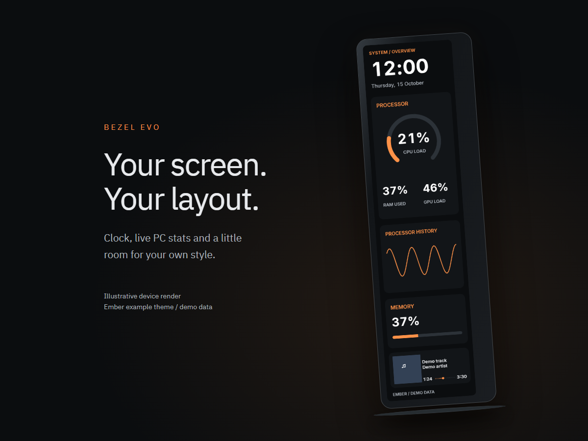
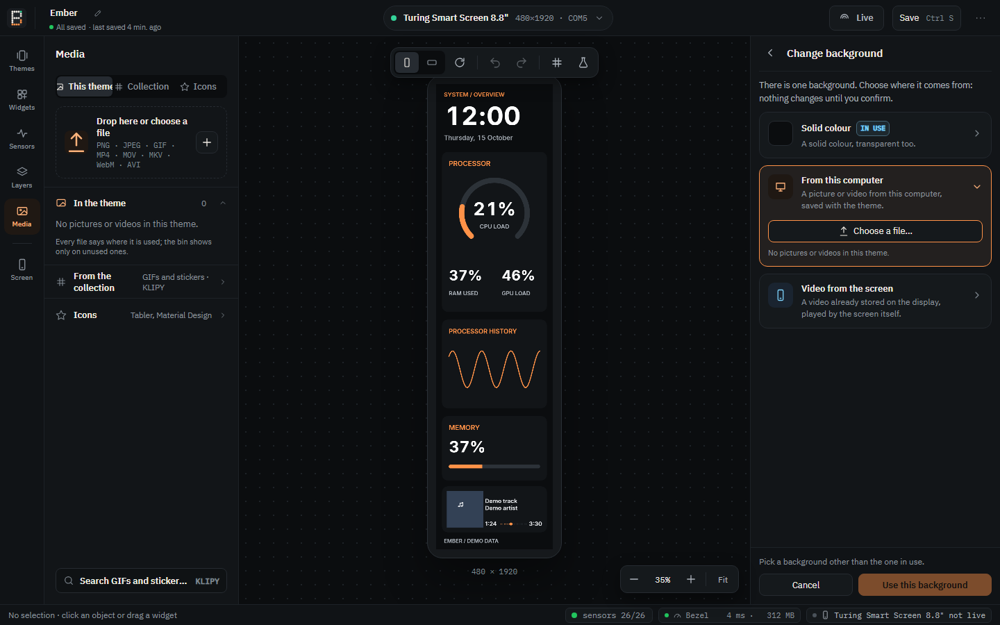
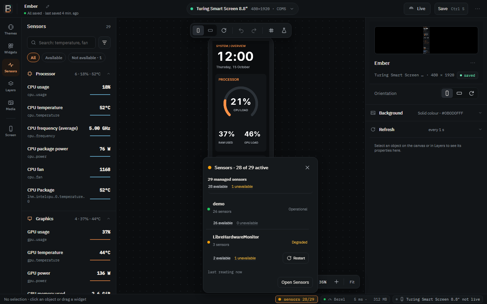
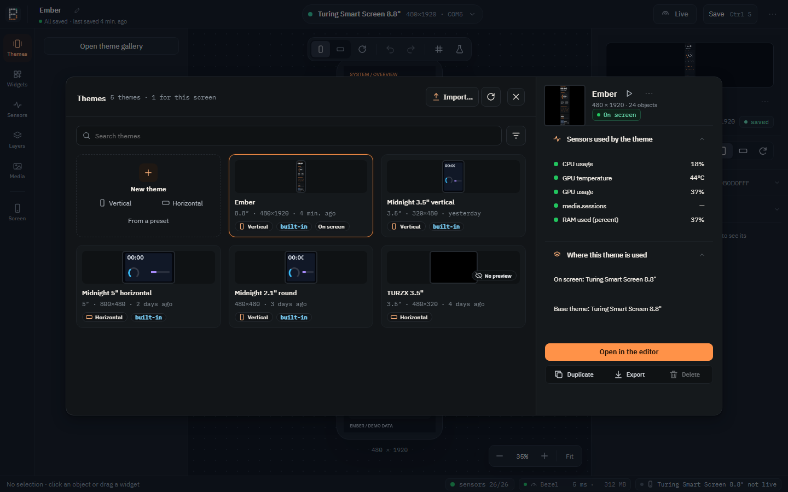
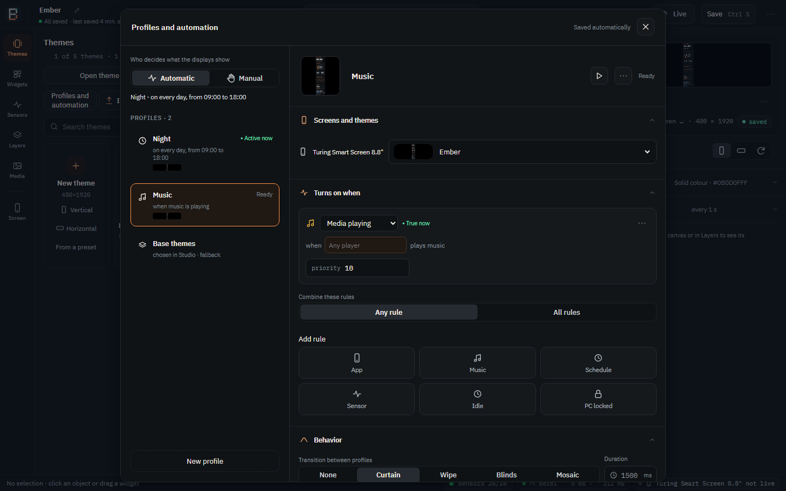
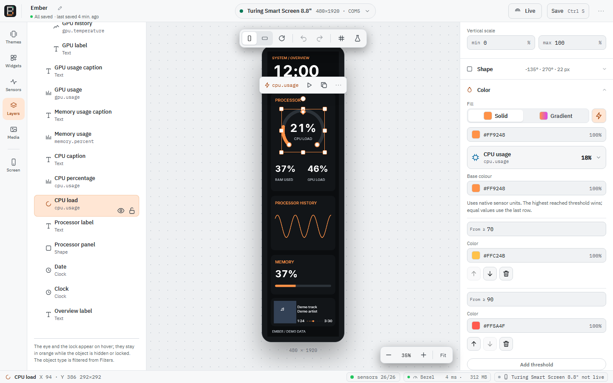

  

<h1 align="center">Bezel Evo</h1>

Make your USB smart screen your own.

  
  
  

https://github.com/user-attachments/assets/92eaa3a0-b369-4ae0-96b4-934210d99f47

Bezel Evo on a Turing 8.8" screen: live sensors, weather and a Card that switches to the song playing.

Studio in demo mode. Example layout and simulated sensor readings.

See the example on a screen

## What's new in 0.2.12

The first published release since 0.2.0; local builds 0.2.1 through 0.2.11 are
included. See the [changelog](CHANGELOG.md) for the complete history.

- **Vendor theme import.** Open `.turtheme` files with available fonts and
  corrected sensor bindings. A new theme starts with a clean canvas and Live
  off, with a visible highlight on the sending control.
- **Videos checked against the display.** Reuse compatible clips already in
  storage. When an imported clip is missing, Studio offers to copy its local
  source or lets you choose a file. Missing video does not block the whole theme.
- **Game FPS and frame pacing.** Average FPS, frame time, 1%/0.1% lows, one-second
  min/max, game and source information. Enable the optional FPS collector once
  in Setup; Studio and Light run as normal Windows applications. RTSS remains
  the main FPS fallback. See [Game FPS](docs/user/fps.md), including recovery
  guidance and the limits of DLSS/Frame Generation identification.
- **Physical-display diagnostics.** Optional delivery FPS, render/transfer time
  and sensor timing reach the hardware display, including static themes. These
  readings are separate from game FPS and never become part of the saved theme.
- **Quieter status and framing controls.** Stable Bezel timing/memory updates
  and video framing selections consistent with the rest of the inspector.

## A new Studio

Studio has been redesigned from the ground up, in dark and light.

- **A calmer workspace.** An icon rail for Widgets, Sensors, Layers, Themes, Media
  and Screen; floating tool bars over a dot-grid canvas; library and properties
  panels you can resize. Layers filter by object type alongside name or sensor
  search, preserving card and group context. In English, Italian and Portuguese.
- **An inspector that shows what you change.** Every object gets a live preview
  of itself at the top of the panel, with ▶ Try, followed by sections you open
  and close: **Layout**, **Data**, **Shape**, **Text**, **Color** and
  **Behavior**, each summarized when closed.
- **Handles on the canvas.** Drag a ring's ends, a needle's zones, a graph's
  scale or a clock's hands directly; the field lights up and arrow keys nudge.
- **One sensor picker everywhere.** Search names, keys, categories or probes,
  with grouped results, live readings, availability and keyboard navigation.
- **One colour picker everywhere.** Colour area, hue, opacity, hex code and an
  eyedropper with a magnified pixel preview, swatch and HEX beside the cursor,
  plus **Theme colours** you save once and reuse, the colours already
  **used in this theme**, and recent ones.
- **A real font picker.** Search, filter Sans/Serif/Mono, each name written in its
  own font, a preview with the object's real text, and only the weights the font
  really has. Fonts come from three places: [included with Bezel, your own fonts
  folder, or packed inside the theme](docs/user/fonts.md).
- **Letter case without rewriting text.** Preserve the original, use upper or
  lowercase, or capitalize the first letter or every word, including live text.
- **Cards that are easy to follow.** A plain list of faces with **Edit** for each,
  a shared background under all of them, **one transition** for the whole Card
  (fade, slide or flip) and **timed triggers** ("every 30 s, the next face")
  next to the app and media triggers.
- **Game frame metrics on demand.** Optional PresentMon service capture with
  RTSS fallback for FPS, plus frame intervals, lows and source information.
  Enable game FPS once in Setup; Studio and Light then run without administrator
  privileges or changes to your Windows account groups. See [Game FPS](docs/user/fps.md).
  [Setup and metric definitions](docs/user/fps.md).
- **Values that glide.** Rings, bars, needles and numbers move smoothly to each
  new reading instead of jumping, with smooth easing or inertia that preserves
  movement when the target changes, without flooding the screen with frames.
- **Movement driven by sensors.** Rotate custom images, icons and shapes with
  fan RPM or another reading, with adjustable visual speed, inertia and direction.
  Zero or missing readings slow them to a stop, also inside cards and groups.
- **Native visualization presets.** Block matrices, pixel arcs, modern dials,
  rounded bars and mirrored two-sensor graphs. [See the styles](docs/user/visualizations.md).
- **Graphs that scroll smoothly.** Line, area and bar histories move between
  real samples, up to 50 fps where rendering and the display allow. Each screen
  follows its own output pace. Sampling stays unchanged; scrolling uses up to
  one sample interval of visual delay and preserves unavailable-reading gaps.
- **Colour by value.** Turn a gauge, a graph, a text or an icon orange above 70
  and red above 90, with as many thresholds as you like.
- **A media player you compose.** Choose the parts (cover, title, artist, time,
  progress, app name) and style the progress bar: continuous, segments or dots,
  round or square ends, a knob, times at the sides or above.
- **An audio spectrum that follows the music.** Five styles: mirrored bars,
  bars rising from the bottom, LED blocks that light up like a level meter, a
  smooth line with a soft fill, and radial bars around a ring. Held peaks, gradients, colour by value and an
  amplitude multiplier come with every style. It listens to the app your Player
  follows or, if you choose, to everything the PC plays, only in memory, and
  can be turned off in Preferences (Windows 11).
- **A clear background chooser.** One card shows the background in use; **Change
  background…** offers a solid colour, a picture or video from this computer, or
  a video already stored on the screen, and nothing changes until you confirm.
- **Quick hands.** Mouse wheel zooms around the pointer, the middle button pans,
  double-clicking an object fits its frame to its content.
- **Status at a glance.** The sensor chip summarizes probes and their available,
  unavailable and unchecked sensor counts. Click a count to open Sensors with
  matching probe/status filters. Restart is available on supported probe rows; a memory
  chip shows how much Bezel uses, per process; **Preferences → Logs** opens the
  logs folder.

## Gallery

| Colours from your theme | Fonts with their real weights |
| :---: | :---: |
|  |  |
| **Card faces and one transition** | **A media player you compose** |
|  |  |
| **Change the background** | **Sensor status** |
|  |  |
| **The theme gallery** | **Profiles and automation** |
|  |  |
| **Light theme** | **On the screen** |
|  |  |

## Light keeps everything running

**Display profiles** switch the complete configuration from the Studio or Light
tray. Manage them from **Themes → Profiles and automation**: each profile, such
as Gaming or Music, assigns a saved theme to each display. A single selection
applies the profile across your screens. Choose who decides: **Automatic**, where
rules pick the profile (and a fallback shows when none holds), or **Manual**,
which always shows the base themes or the profile you pick. Rules cover an app
running or in the foreground, media playing, a sensor above or below a value for
a while, times and days, idle and a locked PC; combine a profile's rules with
*any* or *all*. Each rule reads as a sentence with its own priority and return
delay, and the dialog shows which profile is active now and why. Profiles pause on the display being edited and
resume when Studio is hidden. The **base themes** are the ones chosen in Studio.

Profile changes, and the return to the base themes, use one of four covers:
**Curtain**, **Wipe**, **Blinds** or **Mosaic**. A panel closes over the screen,
the new theme is prepared underneath and the panel opens on its first frame, so
it also works over video a screen plays itself, on any size or shape. Between
1500 and 2500 ms the motion is smoothest; slower displays show fewer frames. The
▶ button tries the transition towards the selected profile on the live displays
and comes back, without saving.

**Bezel Light** is the small tray program that owns your screens. It runs the
themes, reads the sensors, keeps the graph history and clocks, plays the
transitions and decodes background videos, all in one place. Studio is the
editor: while it is open, its canvas shows the very picture Light sends to the
screen.

So opening and closing Studio is seamless: **no redraw, graphs keep their
history, a video keeps playing, the picture stays fluid.** Close Studio without
saving and the screen goes back to the saved theme, still without starting
over. Studio talks to Light over a local channel that only your Windows user
can open; if Light cannot run, Studio drives the screens itself.

## And everything else

- **See your PC's stats.** CPU, GPU, memory, disks, network, fans and power, with
  a bundled hardware sensor reader instead of a separate monitoring app to keep
  open. A value that cannot be read shows why; Bezel never makes one up.
- **Go beyond gauges.** Clocks and dates, weather, now-playing, history graphs
  with their own time window, offline icons, images, animated GIFs and video
  backgrounds.
- **Run multiple screens.** Give each display its own theme and orientation;
  Light drives them together with one sensor reader.
- **Manage the screen's storage.** Send, move, rename and clean up the pictures
  and videos stored on screens that keep them, and choose what they show when the
  PC shuts down.
- **Start from a theme.** Use bundled layouts, import vendor and
  turing-smart-screen-python themes, or save your own as a `.bezeltheme` file.

## Download & install

1. **[Open Releases](https://github.com/jripper77/bezel-evo/releases)** and download the Windows x64 **Setup** or **portable ZIP**.
2. Close the screen's vendor app. Run Setup, or extract the ZIP into a writable folder. Setup offers optional hardware sensors and Light at sign-in.
3. Open **Studio**, select your screen, choose a theme, customise it and **Save**. Turn on **Live** to send it to the display.

**Platform:** Bezel Evo supports **Windows only**.

**Requirements:** Windows 10/11 x64, a compatible USB smart screen and Microsoft Edge WebView2. Setup can download WebView2; portable Studio needs it already installed. Hardware sensors use .NET Framework 4.7.2 or newer; availability depends on your hardware and drivers. FFmpeg is separate for video conversion.

The Setup and the programs are not code-signed, so Windows SmartScreen may warn the first time: choose **More info → Run anyway**. See the [installation guide](docs/user/install.md) for sensor setup and updates.

## Supported screens

| Screen / family | Status |
| --- | --- |
| Turing Smart Screen 8.8" Rev C, ROM 1.90 | **Tested on hardware** |
| Other Turing Rev C models; Turing 3.5" / UsbPCMonitor 3.5" and 5" Rev A | Supported |
| XuanFang 3.5" / Flagship, Rev B | Supported |
| Kipye Qiye 3.5", Rev D | Supported |
| WeAct Studio Display FS 3.5" / 0.96" | Supported |
| TURZX / Turing USB generation, 1.6"-12.3" | Supported |
| WCH-based panels, 2.4"-4.3" | Supported |

"Supported" means a driver is implemented, not that every model or firmware has been physically tested. Check the [screen guide](docs/user/devices.md) and [full model catalogue](docs/reverse-engineering/devices.md) before choosing a display.

## Documentation

- [User guide](docs/user/README.md) / [Your first theme](docs/user/first-theme.md) / [Editing in Studio](docs/user/studio-editing.md) / [Fonts](docs/user/fonts.md)
- [Sensors](docs/user/sensors.md) / [Storage and video](docs/user/storage-and-video.md) / [Troubleshooting and logs](docs/user/troubleshooting.md)
- [What's new](CHANGELOG.md) / [Technical documentation](docs/) / [Windows builds](docs/build-windows.md) / [Fork changes and validation](FORK.md)
- [Whole-scene H.264 experiment](docs/experiments/scene-streaming.md): a developer prototype with mixed independent outputs; not a Studio setting or a hardware-verified frame-rate claim.

## Support

Bezel Evo is free and open source. If it is useful to you, you can support its development on Ko-fi.

## Credits & licence

© 2026 [jripper77](https://github.com/jripper77). Bezel Evo is a **fork of [slipalison/bezel](https://github.com/slipalison/bezel)**, created by [Alison Amorim (@slipalison)](https://github.com/slipalison); original authorship, research and copyright notices are preserved (see [NOTICE](NOTICE)).

Licensed under **[GPL-3.0-or-later](LICENSE)**. See [third-party credits and licences](THIRD_PARTY.md) for LibreHardwareMonitorLib, Tabler, Material Design Icons, IBM Plex, Inter, JetBrains Mono, Doto and weather-data attribution.

Thanks to [DarkK3y-v2](https://github.com/DarkK3y-v2) for the initial FPS contribution ([PR #2](https://github.com/jripper77/bezel-evo/pull/2)).
