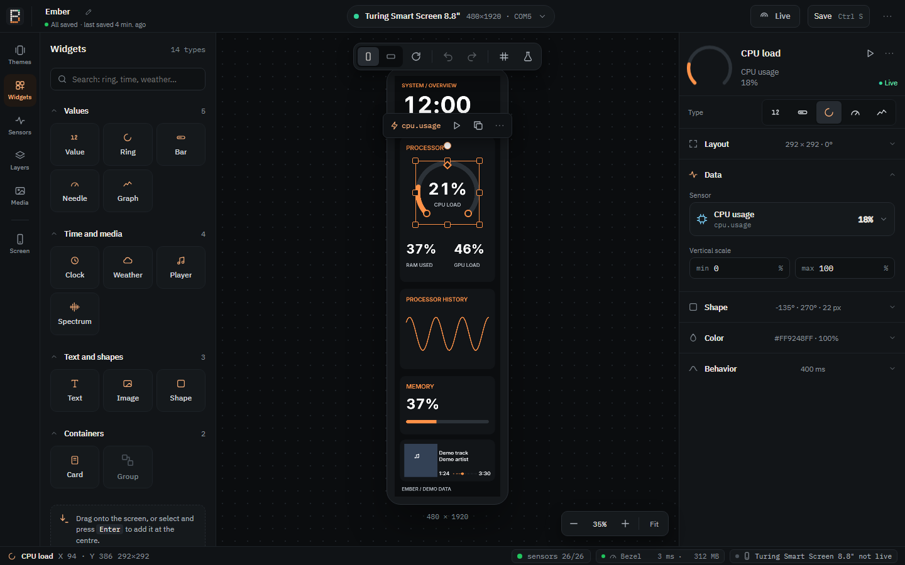
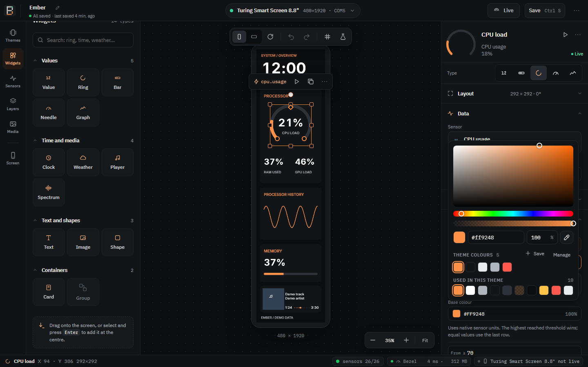
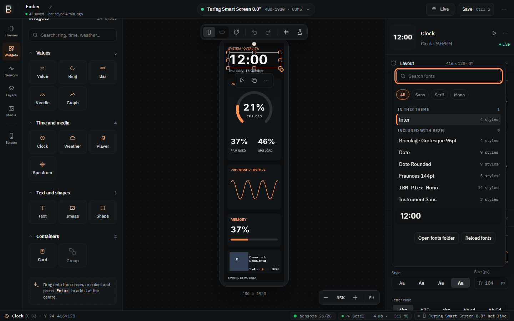
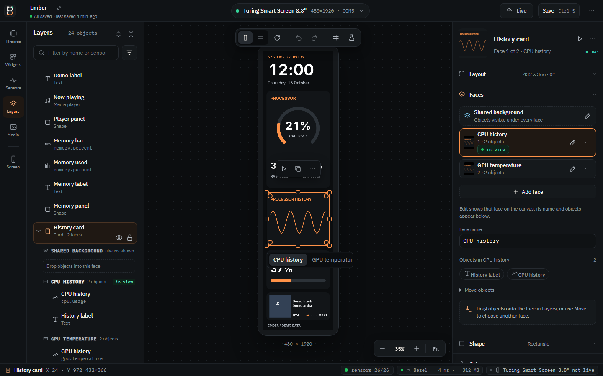
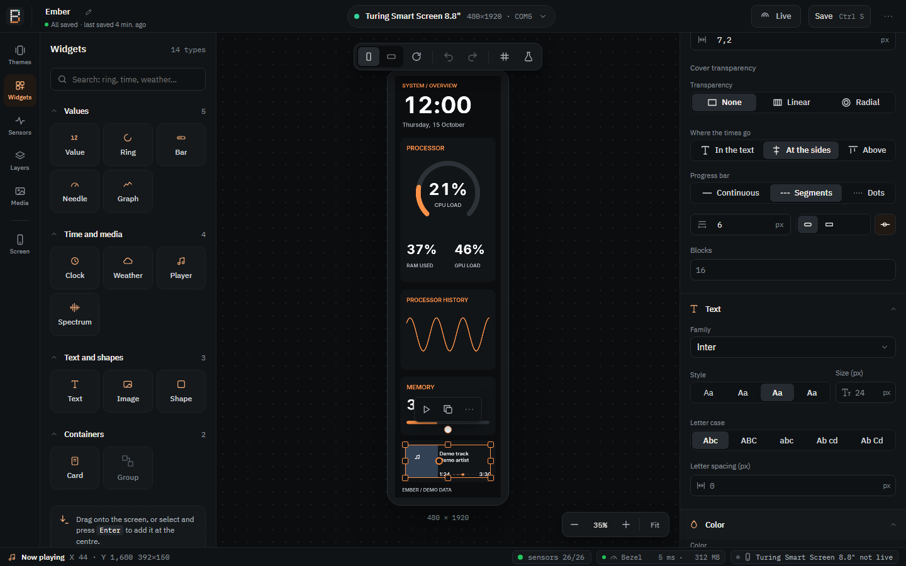

# Editing in Studio

[Your first theme](first-theme.md) walks through the basics. This page covers
every editing tool of Bezel Studio.

## The workspace

- **Icon rail.** **Widgets**, **Sensors**, **Layers**, **Themes**, **Media**
  (Design) and **Screen** (Device). The library panel shows the one you pick.
- **Top bar.** The theme's name, with a pencil to rename it, and under it
  whether everything is saved (*● unsaved changes · last saved 4 min ago*);
  the screen selector, **Live**, **Save** (**Ctrl+S**) and **⋯**, with
  **Preferences** and the version of Studio.
- **Canvas bars.** At the top: **Vertical** / **Horizontal**, rotate 180°, undo,
  redo, **Show guides and grid** and
  [**Trial values**](#trial-values). At the bottom: zoom out, the zoom level,
  zoom in and **Fit**.
- **Status bar.** On the left, what is selected: its name, position and size,
  or while you drag, what the gesture does and the key that changes it
  (*Alt = no snapping*, *Shift = keep proportions*). On the right three chips,
  each opening a panel when clicked:
  - **Sensors** (*sensors 20/21*): how many sensors read, the probes and
    **Restart** ([the sensor status](sensors.md#the-sensor-status));
  - **Bezel** (*Bezel 11 ms · 182 MB*): how long the last frame took to draw
    and how much memory Studio, Light and the sensor reader use, with a graph
    of the last minute and **Copy diagnostics**. It turns yellow when a frame
    takes longer than 33 ms;
  - **Screen** (*Turing 8.8″ 30 fps*): green while live, grey when not, yellow
    when something is wrong. Its panel says what the screen is doing, its
    connection, resolution and frames, the theme and the active
    [profile](profiles.md), with **Screen settings** and **Go live** /
    **Stop live**.
- **Panels.** Drag the edge of the library or of the inspector to resize it;
  Studio remembers the widths.

**Moving around.** The mouse wheel zooms around the pointer (a touchpad pinch
too), from 5% to 800%. Hold the middle button and drag to pan. **Fit** shows the
whole screen. Clicking the empty space around the screen deselects everything.

**Light and dark.** Studio follows Windows' light or dark mode, and its language
(English, Italian or Portuguese) unless you pick one in **Preferences →
Language**.

## Adding and selecting objects

- Drag a widget from **Widgets** onto the canvas, or select it and press
  **Enter** to add it in the middle. Drag a sensor from **Sensors** onto a widget
  to bind it, or onto empty space to create a new value.
- Click an object to select it; **Ctrl+click** or **Shift+click** adds to the
  selection; drag on empty space to select with a rectangle. Objects outside the
  screen's edges stay reachable and show their outline and name.
- Arrow keys move the selection by 1 px (with **Shift**, 10 px).
- **Double-click** an object's frame to fit the frame to what it draws: the
  text of a text, value or clock in its current font, an image or icon at its
  natural proportions, a weather or media player block. **Fit frame to content**
  in the object menu does the same. Each is one undo step.
- Right-click an object on the canvas or in **Layers** (or **Shift+F10**) for
  cut, copy, paste, duplicate, group and ungroup, make a Card, bring to front, move one step forward or backward,
  send to back, detach from a group or Card, hide, lock and delete.
- **Ctrl+C**, **Ctrl+X** and **Ctrl+V** copy, cut and paste objects inside the
  theme, with their settings; **Ctrl+G** groups and **Ctrl+Shift+G** ungroups.

With several objects selected, the alignment buttons line them up on the first
one you selected; with one, they align it on the screen.

In **Layers**, combine the name/sensor search with **Object type** (behind the
funnel button next to the search; a dot on it says a filter is on) to find
text, values, clocks, graphs, images, cards, groups or other widget types.
**All types** clears the type filter. Matching children keep their card/group
ancestry visible; folded containers expand temporarily, then return to their
previous fold state when filters are cleared. A matching card or group shows
its complete contents. Filtering leaves the document and selection unchanged.

## Handles on the canvas

Besides the frame's own handles (move, resize, rotate), a selected object shows
handles for what it draws. While you drag one, its value shows next to the
pointer and the matching inspector field lights up, opening its section. With a
handle focused, the arrow keys step it (**Shift**: a bigger step). A drag is one
undo step.

| Object | Handles |
|---|---|
| Ring | start and end on the circle (**Shift**: steps of 15°), thickness |
| Needle | pivot, length, start and end of the arc, the edges between zones |
| Bar | a **trial value** (below), corners |
| Shape | corners (**Alt**: one corner only); double-click to move and scale a repeated picture |
| Graph | the minimum and maximum of the scale (rounded); double-click for automatic |
| Value and text | text size (**Ctrl** on the bottom-right corner scales the text); click a part (number, unit…) to pick it in the inspector; double-click to write a fixed text |
| Analog clock | the length of each hand; the hands stay on the real time |
| Image | where the picture is anchored when it fills its frame (nine positions), the fade |
| Media player | the fade on the cover, and the divider between cover and texts |
| Card | a tab for each face under the Card, **+** for a new one; double-click a tab to edit that face |
| Spectrum | bar width and gap |
| Several objects | one frame for all, resized in proportion, rotated together when they all can, pink guides with the distance between them |

A bar's trial value holds its sensor where you drag it, so you see the bar at
that level. Nothing is saved, and the screen keeps showing the real reading.

**The floating bar** above the selection holds the linked sensor (click it to
choose another), **▶ Try** (the same trial as the inspector's preview),
**Duplicate** and **⋯** (the right-click menu). It hides during a drag, moves
below the object when the canvas toolbar is in the way, and with several
objects keeps only Duplicate and ⋯.

### Trial values

The test-tube button in the canvas bar shows the whole theme with trial values
instead of the sensors: every bound sensor sweeps from the bottom to the top of
its scale and back in 3 seconds, clocks run, the weather goes through its
conditions, players play and graphs draw a wave. A full cycle takes 24 seconds.
Use it to check that nothing overlaps at 100% or gets lost at 0%. Nothing is
saved and the screen keeps showing the real sensors. It is off when Windows
asks for reduced motion.

## Removing imported media

In **Media → This theme**, each file says where it is used (*in use: Cover,
background*), counting objects on hidden card faces too. Only a file nothing
uses has a trash button, which removes it from the theme's media list: to
remove a file still used by images, needles, fonts or the background, replace
or remove those references first. **+** adds a picture or a video. The original file on your computer is preserved.
Saving includes only assets the theme uses. Session bytes remain available so
Undo can restore a previously removed image object; importing the file again
also restores it to the list.

## The inspector

With nothing selected, the inspector shows the **theme**: a preview, its name,
the screen and its size, whether it is saved (with **Save**, **Save as** and
**Duplicate** in its menu), **Vertical** or **Horizontal** and the 180° turn,
the [background](#the-background) and how often it refreshes (quick values 0.5,
1, 2 and 5 s).

With an object selected, it shows from top to bottom:

- a **header** with a 72 px **live preview**, the object's name and content,
  **▶ Try** and **⋯**. The preview draws the object on its own with the same
  renderer and real readings as the screen. The menu contains **Duplicate**,
  **Delete**, visibility, locking and the other object actions.
  **▶ Try** plays it with trial values: a value
  climbs to its maximum and back, a clock runs through a day, the weather shows
  each condition, a Card shows its next face. Nothing is saved;
- the **sections**, in this order, each only when the object has something in
  it: **Layout** (position, size, rotation, the group or Card it belongs to, and layer order),
  **Data** (sensor and range, text, clock format, weather location, graph
  window, media app), **Shape** (form, arc, ticks, visualization, corners),
  **Text** (font, parts, letter case), **Color** (fills, gradients, shadow,
  transparency) and **Behavior** (transitions, animation, playback,
  sensor-driven motion, long text).

Graphs keep quick time windows visible. Expand **Precision** to edit the custom
duration and sampling interval; the closed summary shows the interval and point count.

Click a section's title to open or close it; **Alt+click** opens it alone and
closes the others. A closed section shows a summary of its values (*240 × 240 ·
0°*). Studio remembers which sections are open for each kind of object.
With several objects selected, the inspector shows a preview of each and only
the fields they share; a field whose values differ says *mixed*.

In **Layout**, **Order** sits immediately after **Part of**. **Front** and **Back**
move to the ends of the current layer list; the arrows move one step. Members
stay inside their group or Card face. Each command is one undo step, including
a multiple selection, whose relative order is preserved. Commands at the edge
or on locked objects or containers are disabled. The layer number appears only
for one selected object. **Duplicate** and **Delete** are in the shared **⋯**
menu in the header and floating bar, and in the right-click menu.

Number fields take the arrow keys and keep their focus while you step.
Scrollable panels use slim rounded scrollbars; source descriptions in Sensors
wrap within the panel rather than forcing horizontal scrolling.

### Choosing a sensor

Click the source card to open the same sensor picker used for widget data,
colour rules and sensor-driven motion. Search by name, key, category or probe.
Results are grouped by category and show the probe, current reading and status;
pending or unavailable readings remain visible. Numeric controls exclude text
sensors. Use the arrow keys and Enter to choose, or Escape to cancel.

### Sensor-driven motion

Select an image, icon, shape or another ordinary widget and open **Behavior →
Sensor-driven motion**. Turn on **Rotate with the sensor**, then choose a
numeric sensor. Containers and device-video cutouts do not offer this control;
ordinary objects inside cards and groups do.

For a fan graphic, choose its RPM sensor, set **Full speed at** to
3000 RPM, **One turn every** to 1 s and **Start and stop** to **Gradual**.
A reading of 1500 approaches one turn every 2 s. This is a visual scale: the animation
does not try to reproduce thousands of physical revolutions per minute.

**Start and stop** offers **Immediate**, **Gradual** and **Soft** responses.
Existing custom inertia settings are preserved and shown as **Custom**.
Zero, negative or unavailable readings slow the graphic to a stop, holding its
last angle. **Counterclockwise** reverses the direction. Motion applies around
the frame centre, so centre the artwork within its image for a balanced rotor.

The live preview uses the same motion as the display, with enough transparent
space for every angle. Reduced motion shows the authored static orientation.
Sensor sampling stays unchanged; each display renders at its own output pace,
requesting up to 50 frames/s while the graphic moves, subject to rendering and
transfer costs. The stored rotation and object frame are not changed by playback.

### Colours

Every colour in Studio opens the same **colour picker**:

- a saturation and brightness area, a hue bar and an opacity bar (all usable with
  the arrow keys), the **hex code** and the opacity in %;
- an **eyedropper** to pick a colour on any monitor, with a magnifier, marked
  centre pixel, colour swatch and HEX value beside the cursor;
- **Theme colours**: click **Save** to keep the current colour in the theme, then
  click a swatch to use it again. **Manage** renames, reorders and deletes them.
  A saved colour is a starting point: changing it does not repaint what already
  uses it;
- **Used in this theme**: the colours already in the theme, the most used first;
- **Recent**: the colours you picked lately.

Each change is one undo step; dragging in the area is one step too.

During a desktop pick, the selection surface freezes temporarily so the preview
and selected pixel match exactly. Move to inspect pixels and click to select;
Escape or right-click cancels. The capture stays in memory only until the pick
ends. The existing opacity is preserved.

### Fonts

The **Family** button opens the **font picker**:

- search by name, and filter **All**, **Sans**, **Serif** or **Mono**;
- sections **In this theme**, **Recent**, **Theme fonts**, **Included with
  Bezel**, **My fonts** and **System fonts**, each name written in its own font;
- a preview with the object's real text (its value, the time, the song playing);
- **Open fonts folder** and **Reload fonts** for your own fonts.

**Style** then offers only the weights and italics that font really has. A theme
that asks for a font this PC does not have shows **Not installed** and the font
the screen uses instead. See [Fonts](fonts.md) for the three places fonts come
from and how to pack one inside a theme.

### Smooth values

Rings, bars, needles and values can glide to each new reading instead of
jumping. In **Behavior → Transition**, pick **Smooth** and a duration (100 to
2000 ms), or **Inertia** and a settling time. Inertia preserves the current
position and velocity when a new reading arrives, then slows towards the new
target. **None** updates immediately. Older Bezel builds open inertial themes
using a smooth transition. New objects start smooth at 400 ms; themes made before keep jumping
until you turn it on. Studio and Light send extra frames only while something
moves, and fewer to a slow screen; if a screen cannot keep up, it shows the new
value at once. The editor honours Windows' reduced-motion setting.

### Colour by value

Texts, values, rings, bars, needles, graphs, shapes and SVG icons can change
colour with a sensor's value. In **Color**, turn on **Colour by value**, choose
the sensor (a bound object uses its own), a **Base colour**, then **Add
threshold**: *From ≥ 70* orange, *From ≥ 90* red. Values use the sensor's own
units; the highest threshold reached wins.

### Corners

Shapes, Cards, images and the player's cover share one corners control:
**Equal** (one radius) or **Individual** (each corner), with a drawing of the
four corners that shows what you set at any size.

### A picture inside a shape

A shape can show a picture (PNG, JPEG, GIF or SVG) over its fill and under its
outline, cut to the shape: a rounded panel with a texture, an ellipse with a
photo, a strip of repeated icons. Add the picture to the theme first (Media,
or an icon), then select the shape and choose it in **Image**. The tiles under
it set how it covers the shape:

- **Fill (crop)** covers the shape and crops what overflows;
- **Fit inside** shows the whole picture, with the fill around it;
- **Stretch** follows the shape's box exactly;
- **Center** shows one copy at its own size;
- **Tile**, **Tile across** and **Tile down** repeat it in both directions,
  along one row or down one column.

For Center and the three tiles, **Image size** scales the picture (100 % is its
own size) and **Shift right / Shift down** move the copies. **Image opacity**
fades the picture without touching the fill. SVG pictures stay sharp at any
size, and an animated GIF keeps playing. A shape used as a video window shows
the screen's video instead.

### Values and texts

- **Text → Time parts** for a clock, or the parts of a value (prefix, number,
  unit, suffix): each part can have its own font, weight, colour and
  **Relative size**, and **Raised** lifts it like an exponent (*4.72* with a
  small raised *GHz*). A part you leave alone follows the whole text.
  On the canvas, click a part to pick it.
- **Fixed-width digits** (on by default) keeps every digit the same width, so a
  changing number does not wobble.
- A text longer than its frame can **Shrink**, be **Cut …** or **Scroll**.
- A value's **Behavior → Transition** also offers **Count** (the number runs to
  the new reading) and **Roll** (digits turn like an odometer), and **Average
  over readings** smooths a jumpy sensor.
- A text can have a soft **shadow**, with its colour and blur.

### Clocks

A clock is **Digital** or **Analog**. Digital clocks take a format with time
codes (**Insert time code**), a language, their own style for hours, minutes,
seconds and separators, and **Blinking separators**. Analog clocks set the
**Dial** (ticks, **Numbers** 3 6 9 12, 1–12 or Roman, border, **Dial face**
colour), each of the three **Hands** with its colour, the **Hand shape**, a
**Date on dial** and whether the second hand steps or sweeps. Switching back to
digital keeps the digital format.

### Needles

A needle can be drawn as a full gauge: an arc with **Zones** (up to eight, in
the sensor's units, each with a colour; the needle can take the colour of its
zone) or a single colour or gradient, **Ticks and numbers**, the needle's shape
(**Thin**, **Tapered**, **Arrow**, **Dot**), **Length** and **Tail**, a **Pivot
cap**, a **Centre value** styled like a value, and a **Peak marker** that stays
at the highest reading for a while, then falls back. A needle made before keeps
its simple look until you change it.

### Weather

**Behavior → Icon animation** moves the weather icon: **Still**, **Gentle** or
**Lively**, with a speed. Each condition has its own movement (the sun turns
and glows, clouds drift, rain and snow fall, lightning flashes) and changing
condition fades in 300 ms. New weather objects start **Gentle**; reduced motion
keeps the icon still.

### Images and GIFs

When a picture fills its frame, the **Anchor point** chooses which part stays
in view (nine positions, also draggable on the canvas). An animated GIF has
**Playback** (**Loop** or **Once**, stopping on its last frame) and **Playback
speed**.

### Graphs

A graph has its own time window, independent of the theme's refresh. In
**Data → Time window**, pick a quick value (30 s, 1 min, 5 min, 15 min, 1 h) or
write the sentence *Show the last [1] [minute], with one point every [1]
[second]*; a ruler shows the window and how many points it draws (2 to 3600).
**Vertical scale** is **Automatic** (fits the highest value in view) or
**Fixed** (min and max).

## Cards

A **Card** shows one of several **faces** at a time, with a transition between
them. Add one from **Widgets**, or select objects and choose **Make card** in
**Layers** or in the right-click menu.

The Card's inspector has the sections **Layout**, **Faces**, **Shape**, **Color**
and **Behavior**; its header says which face is in view and how many there are.

**Faces.**

- The faces are a list: number, name, **in view** on the face the screen shows,
  the pencil to show that face on the canvas and edit its objects, and a **⋯**
  menu with **Rename**, **Duplicate**, move earlier or later, and **Delete**.
  **+ Add** adds a face. On the canvas, the tabs under the Card do the same.
- **Shared background** holds the objects visible under every face; edit it
  like a face.

**Behavior.**

- **Transition between faces**: one effect for the whole Card (none, fade, slide
  or flip), its duration (150 to 1500 ms), for slide and flip its direction, and
  whether the shared background moves with the faces. **▶ Try** in the
  inspector's header plays it.
- **Timed triggers** change the face at regular intervals: *every 30 s → show
  the next face* (or a given face). **Add timed trigger** adds one.
- **App triggers** show a face for a while: when an application is running, is
  closed, is in the foreground, or when media is playing (in any app or in one
  you name). Each rule has a **priority** and a **return** delay; drag the
  handle, or use its arrow keys, to reorder. **When a trigger ends** chooses the
  face to go back to.
- Timed changes pause while you edit the Card or while an app trigger is
  active. Deselect the Card to see them run.

Themes made with the older "rotate every N seconds" setting become a timed
trigger when opened.

## Media player

The **Media player** shows what Windows' media sessions publish: Spotify, a
browser, a video player. Covers and titles depend on what each app publishes.

- **Data**: **Which app** (automatic, an app playing now, or **Other…** by name),
  **When nothing plays** (hide the player or show a text) and the **Times
  shown** (elapsed / total, elapsed / remaining, elapsed, remaining or total).
- **Shape → What to show**: turn **Cover**, **Title**, **Artist**, **Time**,
  **Progress** and **App name** on or off. Several players with different parts
  make a layout of your own (a big cover here, the title there).
- **Shape → Progress bar**: fill and track colours, thickness, round ends, a knob
  at the position, **Continuous**, **Segments** or **Dots**, and where the times
  go (**In the text**, **At the sides**, **Above**).
- **Cover corners** and the spacing between cover and text.

## The background

With nothing selected, the theme's **Background** card shows the background in
use: a preview, its kind, the file, and whether the screen stores it.

**Change background…** opens three sources inside the inspector, one at a time:

- **Solid colour**, transparent too;
- **From this computer**: a picture or a video, saved with the theme;
- **Video from the screen**: a video already stored on the display, played by the
  screen itself. A source the screen cannot use is greyed out with the reason.

Nothing changes until **Use this background**; the footer shows the old and the
new background. **Cancel**, **Back** or Esc leave everything as it was, and the
change is a single undo step. Video framing (rotation, fill or fit, zoom,
position) is described in [Framing the video](storage-and-video.md#framing-the-video).

## Layers

**Layers** lists the objects, the topmost first, with their kind or sensor.
**Filter by name or sensor** finds one. Drag rows to reorder them, or into a
group, a Card face or its shared background. Select several (Ctrl+click) to
**Group** them (**Ctrl+G**) or **Make card**. Each row can be hidden, locked and
renamed (double-click the name). Cards show their shared background and each
face, with **in view** on the shown one and how many objects it holds. With
several rows selected, the bar under the list also offers **Align** (six
alignments and two distributions, as in the inspector).

## Widgets and Sensors

**Widgets** groups the widget kinds in four groups you can fold: values, time
and media, text and shapes, containers. A search opens the groups that match.

**Sensors** lists the sensors by category, each with its main reading in the
title. A row shows the full name and the value, then the key and a small
graph; a sensor that cannot be read shows *—* and why (*not available ·
needs LibreHardwareMonitor*). The chips **All**, **Available** and
**Unavailable** filter the list; probe and status are behind the funnel button.

## Themes and the gallery

**Themes → Open theme gallery** shows every theme as a real preview, with
search, filters and the newest first. Select one to see its size and number of
objects, the sensors it reads (with their current values, and the ones this PC
cannot read), and where it is used: the base theme of a screen, or a
[profile](profiles.md). From there: **Open in the editor**, **Duplicate**,
**Export .bezeltheme…** and **Delete**. A theme in use, or one included
with Bezel, cannot be deleted. **▶** on a theme shows it on the live screen
for 30 seconds, then the screen goes back to what it showed; nothing is saved.
A new theme starts empty or as a copy of one included with Bezel.

Bezel includes, among others, four horizontal themes for 1920×480 screens:
**Pixel**, **Nebula**, **Paper** and **Now Playing**.

## Saving

**Save** (**Ctrl+S**) saves to the theme's file, or to your library for a new
theme. **Themes → Save as .bezeltheme…** (**Ctrl+Shift+S**) saves a copy, with
its pictures, videos and included fonts, wherever you choose. A background video
stored only on the screen stays a reference to the screen: it is not downloaded
when saving.

## Preferences

**⋯ → Preferences**, in the top bar, opens **Preferences**:

- **Language** of Studio and of Light's tray menu;
- **Debug**: diagnostic logs and on-screen readings, for reporting a problem;
- **Logs**: where the logs are, with **Open logs folder**
  ([Troubleshooting](troubleshooting.md#logs));
- **Sensors**: the ping target.

Implementation notes and validation for each feature are in
[the fork notes](../../FORK.md).
